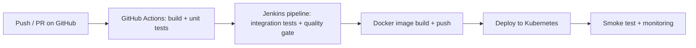

<div align="center">

# Hi, I'm Prajwal Negi 👋

### Backend Engineer · Java & Spring Boot · System Design | B.Tech @ NSUT '26


<br/>


</div>

<br/>

## 🚀 About Me

I build **production-minded backend systems** with **Java and Spring Boot**: clean domain models, event-driven services, cached and searchable data layers, and automated pipelines that ship to Kubernetes. I like the full picture, from the class diagram (LLD) to the architecture diagram (HLD) to the deployment.

```yaml
name: Prajwal Negi
role: Backend Engineer | B.Tech @ NSUT '26
core_stack: Java | Spring Boot | Spring Security | Spring Data JPA | Hibernate | Maven/Gradle
messaging_and_caching: Apache Kafka | Redis | RabbitMQ
search_and_data: Elasticsearch | PostgreSQL | MySQL | MongoDB
devops: Jenkins | GitHub Actions | Docker | Kubernetes | Nginx | AWS
observability: Prometheus | Grafana | Loki
design_focus: HLD | LLD | Design Patterns | Distributed Systems | Event-Driven Architecture
dsa: "1500+ problems solved"
also_worked_with: [Node.js, TypeScript, Next.js, Go, React, Django, Flutter, LangChain, LangGraph, OpenCV, YOLO, BullMQ]
currently_learning: Kubernetes in depth | AWS | Advanced System Design
currently_building: Event-driven microservices with Spring Boot + Kafka
looking_to_collaborate: Backend Systems | Distributed Applications | Open Source
portfolio: https://www.prajwalnegi.site/
reach_me: prajwal.negi.ug22@nsut.ac.in
achievements: "Research Intern @ WorldQuant | 1st Place ESYA Drone Race | 3rd Place National Grappling"
fun_fact: "Can debug distributed systems before my coffee gets cold ☕"
```

## 🎯 What I Focus On

| Area | What it means in practice |
|:---|:---|
| ☕ **Java & Spring Boot** | REST APIs, Spring Security (JWT/OAuth2), Spring Data JPA, validation, exception handling, actuator, profiles, testing with JUnit & Mockito |
| 🏗️ **HLD** | Load balancing, API gateways, sharding & replication, CAP/PACELC, rate limiting, caching strategies, consistency models, capacity estimation |
| 🧩 **LLD** | SOLID, GoF design patterns, clean class design, concurrency-safe components (parking lot, rate limiter, LRU cache, elevator, BookMyShow-style problems) |
| 📨 **Kafka** | Topics, partitions, consumer groups, idempotent consumers, retries + DLQ, event-driven & saga-style workflows |
| ⚡ **Redis** | Cache-aside / write-through, TTL & eviction, distributed locks, rate limiting, leaderboards, pub/sub |
| 🔎 **Elasticsearch** | Index design, analyzers, full-text search, aggregations, syncing data from the primary DB through events |
| 🔁 **CI/CD** | Jenkins pipelines (declarative Jenkinsfile), GitHub Actions workflows: build, test, scan, containerize, deploy |
| ☸️ **Kubernetes** | Deployments, Services, Ingress, ConfigMaps/Secrets, HPA, probes, rolling updates |
| 🧠 **DSA** | 1500+ problems: graphs, DP, trees, heaps, sliding window, binary search, backtracking |

## 🛠️ System Design Toolkit

<details open>
<summary><b>📐 HLD checklist I follow</b></summary>
<br/>

1. Clarify functional & non-functional requirements (scale, latency, availability)
2. Back-of-the-envelope estimation: QPS, storage, bandwidth
3. API design and data model
4. High-level components: gateway, services, DB, cache, queue, search
5. Deep dive: scaling bottlenecks, partitioning, replication, consistency
6. Reliability: retries, timeouts, circuit breakers, idempotency, DLQ
7. Observability: metrics, logs, traces, alerts

</details>

<details>
<summary><b>🧩 LLD patterns I reach for</b></summary>
<br/>

- **Creational:** Factory, Builder, Singleton
- **Structural:** Adapter, Decorator, Facade, Proxy
- **Behavioral:** Strategy, Observer, State, Command, Chain of Responsibility
- Principles: SOLID, DRY, composition over inheritance, dependency injection (Spring IoC)

</details>

<details>
<summary><b>🔁 CI/CD flow</b></summary>
<br/>



</details>

## 🧰 Tech Arsenal

<div align="center">

<br/>
<br/>


</div>

<br/>

<details open>
<summary><b>🧠 Skill Breakdown</b></summary>
<br/>

| Domain | Technologies |
|---|---|
| ☕ **Backend (Primary)** | Java, Spring Boot, Spring Security, Spring Data JPA, Hibernate, Spring Cloud |
| 🌐 **Backend (Also)** | Node.js, Express, TypeScript, Go, Django |
| 📨 **Messaging & Cache** | Kafka, RabbitMQ, BullMQ, Redis |
| 🔎 **Search & Databases** | Elasticsearch, PostgreSQL, MySQL, MongoDB |
| ☁️ **DevOps / Cloud** | Jenkins, GitHub Actions, Docker, Kubernetes, AWS, GCP, Nginx |
| 📈 **Observability** | Prometheus, Grafana, Loki |
| 🖥️ **Frontend** | React, Next.js, Redux, TailwindCSS |
| 🤖 **AI / ML** | PyTorch, TensorFlow, OpenCV, LangChain, LangGraph |
| 📱 **Mobile & Web3** | Flutter, Android (Kotlin), Solidity |

</details>

## 🏆 Achievements

- 🧮 **1500+** DSA problems solved
- 📈 **Research Intern** @ WorldQuant
- 🚁 **1st Place**: ESYA Drone Race
- 🥋 **3rd Place**: National Grappling

## 📜 Certifications

<div align="center">

| Certificate | Issuer | Link |
|:---|:---|:---:|
| 📊 **Data Science** | Coding Blocks | [View](https://online.codingblocks.com/app/certificates/CBOL-293598-3a205461) |
| 📱 **Flutter Development** | Udemy | [View](https://udemy-certificate.s3.amazonaws.com/image/UC-cd23da7b-7f74-426f-a08c-686206dbee98.jpg) |
| 🤖 **Android Development** | Coding Blocks | [View](https://online.codingblocks.com/app/certificate/CBOL-277176-a6f2dcd5) |
| ⛓️ **Blockchain Development** | Udemy | [View](https://www.udemy.com/certificate/UC-87af25c2-5f52-45dd-af64-dc641140a642) |

</div>

## 📊 GitHub Analytics

<div align="center">


</div>

## 🐍 Contribution Snake

<div align="center">

</div>

> 💡 *The snake auto-generates once the [`platane/snk`](https://github.com/Platane/snk) GitHub Action is set up on your profile repo.*

## 🌐 Let's Connect

<div align="center">

<a href="https://www.prajwalnegi.site/" target="_blank"></a>
<a href="mailto:prajwalnegi2301@gmail.com"></a>
<a href="https://linkedin.com/in/prajwal-negi-19797724b" target="_blank"></a>
<a href="https://twitter.com/negi31971" target="_blank"></a>
<a href="https://instagram.com/prajwalnegi" target="_blank"></a>

<br/><br/>

*"Make it work, make it right, make it scale."* ⚙️

</div>
